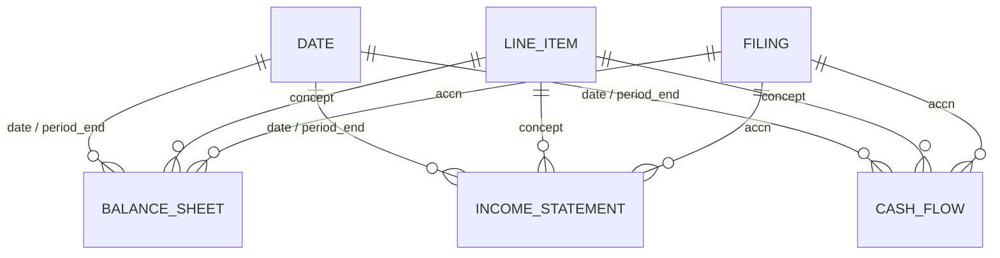

# NVIDIA Financials (Direct Lake)

Direct Lake on OneLake semantic model for workspace **NVIDIA-BalanceSheet-AI**, sourced from lakehouse **NVIDIALakehouse** (schema-enabled). Built by `fabric/notebooks/nb_semantic_model.ipynb` — run that notebook in Fabric (Python kernel). This folder is documentation only; the live model lives in the workspace.

**Guiding question:** *How has NVIDIA's financial position changed?*

## How to run

1. Gold tables must already exist (`nb_bronze_silver_gold_sec_edgar.ipynb`, then `nb_gold_dim_date.ipynb`).
2. In **NVIDIA-BalanceSheet-AI**, import `fabric/notebooks/nb_semantic_model.ipynb` (or open it if already imported).
3. Attach default lakehouse **NVIDIALakehouse**.
4. Set the kernel to **Python** (not PySpark — avoids trial Spark HTTP 430).
5. Run the first cell (`%pip install -q semantic-link-labs`) if the environment does not already have it. `sempy` is preinstalled; no tokens or secrets are used (the notebook runs as the signed-in user).
6. Run all. The notebook creates the model only when a semantic model named exactly `NVIDIA Financials` is absent. If that name already exists, it **does not delete or overwrite** the item; it updates relationships and measures in place via TOM.
7. Confirm the last cell prints **OVERALL: PASS** for the FY2026 totals.

XMLA **read/write** must be enabled on the capacity for the TOM update cell (`connect_semantic_model(..., readonly=False)`). If that cell fails, enable XMLA Read/Write on the trial capacity and rerun from that cell — generation may already have created an empty-ish model.

## Tables

Friendly model names; source columns keep gold snake_case so DAX stays aligned with the lakehouse (a deliberate deviation from title-case column naming).

| Model table | Lakehouse source | Grain / role |
|---|---|---|
| `Balance Sheet` | `gold.balance_sheet` | Long instant lines; one row per concept × period × filing version |
| `Income Statement` | `gold.income_statement` | Long duration lines |
| `Cash Flow` | `gold.cash_flow` | Long duration lines; `is_ytd` flags 10-Q windows with `duration_days > 100` |
| `Date` | `gold.dim_date` | Contiguous calendar + NVIDIA fiscal calendar. Marked as the date table on `date`. |
| `Line Item` | `gold.dim_line_item` | Curated us-gaap concept map (unique `concept`) |
| `Filing` | `gold.dim_filing` | One row per accession (`accn`) |
| `_Measures` | calculated `ROW("Dummy", BLANK())` | Measures home (Import). No relationships. The `Dummy` column is hidden. |

Storage mode: Direct Lake on OneLake (`use_sql_endpoint=False`). The six gold tables are Direct Lake. All 84 measures live on the calculated **`_Measures`** table (`ROW("Dummy", BLANK())`, Import, placeholder column hidden). That calculated table does not reference Direct Lake columns, which is supported in every Direct Lake mode; a lakehouse stub is not used. Display folders are `Category\\<group>\\<subject>` plus `Pages\\<page>` where mapped. See `docs/measures.md`.

## Relationships

All are many-to-one, single-direction, active. `Filing[reportDate]` is **not** related to `Date` (that path would be ambiguous with fact `period_end` → `Date`).

| From | To |
|---|---|
| `Balance Sheet[period_end]` | `Date[date]` |
| `Income Statement[period_end]` | `Date[date]` |
| `Cash Flow[period_end]` | `Date[date]` |
| `Balance Sheet[concept]` | `Line Item[concept]` |
| `Income Statement[concept]` | `Line Item[concept]` |
| `Cash Flow[concept]` | `Line Item[concept]` |
| `Balance Sheet[accn]` | `Filing[accn]` |
| `Income Statement[accn]` | `Filing[accn]` |
| `Cash Flow[accn]` | `Filing[accn]` |

Join types: `Date[date]` and fact `period_end` are Delta **Date** columns (cast with `to_date` in `nb_bronze_silver_gold_sec_edgar` before `saveAsTable`). The semantic-model notebook does not change column types; if they do not match, it exits and asks you to rerun the gold notebook.

## Measures (01-base)

Hosted on **`_Measures`** (display folders under `Category\\01 Base\\…` and the Pages folders in `dax/measure-folders.csv`). Point-in-time and duration measures all use the **single latest `period_end` in the current filter context** with `is_latest_filing = TRUE`. They never `SUM` across fiscal quarters (a fiscal-year date slicer includes Q1–Q3 and FY ends; summing would double-count).

| Measure | Concept(s) | Notes |
|---|---|---|
| Total Assets | `Assets` | Instant, last period in context |
| Total Liabilities | `Liabilities` | Instant |
| Total Equity | `StockholdersEquity` | Instant |
| Cash | `CashAndCashEquivalentsAtCarryingValue` | Instant |
| Long-Term Debt | `LongTermDebtNoncurrent` | Instant; **not** total debt (leases / current portion stay separate) |
| Revenue | `RevenueFromContractWithCustomerExcludingAssessedTax`, else `Revenues` | Duration, last period only |
| Net Income | `NetIncomeLoss` | Duration, last period only |
| Operating Cash Flow | `NetCashProvidedByUsedInOperatingActivities` | Raw; YTD when `[Cash Flow Is YTD]` is 1 |
| CapEx (hidden) | `PaymentsToAcquirePropertyPlantAndEquipment` | Missing from NVIDIA companyfacts after mid-FY2020 |
| Free Cash Flow | OCF − CapEx | **BLANK** when CapEx is missing (including FY2026) |
| Revenue YoY % | prior fiscal quarter-end on `Date` | Matches `fiscal_year` / `fiscal_quarter`, not `SAMEPERIODLASTYEAR` |
| Net Income Margin % | Net Income / Revenue | |
| Debt to Equity | Long-Term Debt / Total Equity | LT debt only |
| Cash Flow Is YTD | `is_ytd` at last CF period | 1 for 10-Q YTD windows |

FY2026 10-K check (period end 2026-01-25), asserted by the notebook:

| Measure | Expected |
|---|---|
| Total Assets | 206,803,000,000 |
| Total Liabilities | 49,510,000,000 |
| Total Equity | 157,293,000,000 |
| Revenue | 215,938,000,000 |
| Net Income | 120,067,000,000 |

DAX source of record for git: `dax/01-base/*.dax` and `dax/_all-measures.dax`.
